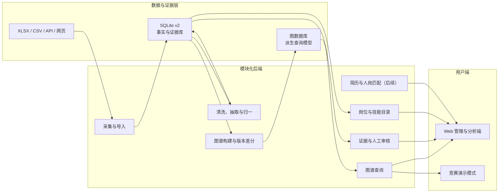

# 多源异构数据驱动岗位能力图谱系统：总体架构与开发计划

## 1. 架构决策

首个竞赛版本采用“模块化单体 + 后台任务进程”，不在早期拆成多个微服务。原因是当前团队需要优先完成端到端闭环、测试和演示，模块化单体能够保留清晰边界，同时降低部署、联调和故障定位成本。

核心决策：

1. SQLite v2 是事实与证据源，保存原始 JD、抽取结果、证据、审核和版本。
2. 图数据库是可重建的查询读模型，不成为唯一事实源。
3. 所有图谱节点和边使用稳定业务键，转换任务必须幂等。
4. 图谱边必须能够回溯到 JD 证据，不允许只有模型结论。
5. 先完成能力图谱模块，再按已定义边界接入新岗位发现、简历解析和人岗匹配。

## 2. 总体逻辑架构



## 3. 部署单元

| 部署单元 | 职责 | 首版进程 |
|---|---|---|
| `web` | 页面、路由、图谱交互、审核界面 | 前端进程 |
| `api` | REST API、鉴权、查询编排、任务提交 | 后端进程 |
| `worker` | 图谱构建、版本差分、导入、批量验证 | 后台进程 |
| `sqlite` | 事实、证据、任务状态和审核记录 | 单文件数据库 |
| `graph-db` | 图遍历、邻域和路径查询 | 独立容器，可重建 |

首版不引入消息中间件。`api` 将任务写入 `graph_sync_runs` 或后续统一的 `pipeline_runs`，`worker` 轮询领取。并发和失败恢复需求上升后，再替换为任务队列。

## 4. 后端模块边界

| 模块 | 内部职责 | 对外接口前缀 | 依赖 |
|---|---|---|---|
| 数据目录 | 岗位、技能、分类、企业查询 | `/api/v1/jobs`, `/skills`, `/categories` | SQLite |
| 图谱查询 | 全景、邻域、路径、聚合 | `/api/v1/graph` | 图数据库，SQLite 降级 |
| 图谱构建 | 快照、全量/增量同步、校验 | `/api/v1/admin/graph-builds` | SQLite、图数据库 |
| 演化分析 | 快照比较、变化说明 | `/api/v1/evolution` | SQLite |
| 证据中心 | JD 证据、来源和可信度 | `/api/v1/evidence` | SQLite |
| 人工审核 | 任务领取、审批、驳回 | `/api/v1/admin/reviews` | SQLite |
| 数据流水线 | 导入、清洗、抽取、质量报告 | `/api/v1/admin/pipeline` | SQLite、文件存储 |
| 人岗匹配 | 简历、目标岗位、差距与路径 | `/api/v1/matching` | 后续模块 |

接口不直接返回图数据库的内部节点 ID。前端使用 `job:24`、`skill:17` 等稳定键，避免重建图数据库后链接失效。

## 5. 推荐代码结构

```text
apps/
  web/                         # Web 前端
  api/                         # API 启动入口
src/
  domain/                      # Job、Skill、Evidence、Snapshot 领域对象
  application/                 # 查询、构建、审核用例
  infrastructure/
    sqlite/                    # 事实库仓储
    graph/                     # 图数据库仓储
    files/                     # XLSX、简历和导出文件
  interfaces/
    http/                      # REST 路由与 DTO
    worker/                    # 后台任务处理器
tests/
  unit/
  integration/
  contract/
  e2e/
database/
  migrations/
docs/
  api/
```

## 6. 核心内部接口

```python
class FactRepository(Protocol):
    def list_jobs(self, filters, page): ...
    def get_job(self, job_id: int): ...
    def get_current_job_skills(self, job_id: int): ...
    def get_evidence(self, mapping_id: int): ...
    def get_snapshot(self, snapshot_id: int): ...

class GraphRepository(Protocol):
    def upsert_nodes(self, nodes, idempotency_key: str): ...
    def upsert_edges(self, edges, idempotency_key: str): ...
    def delete_snapshot_projection(self, snapshot_code: str): ...
    def neighborhood(self, node_key: str, depth: int, filters): ...
    def shortest_path(self, source_key: str, target_key: str): ...

class GraphBuildService(Protocol):
    def build_snapshot(self, snapshot_id: int, mode: str): ...
    def validate_projection(self, snapshot_id: int): ...

class SnapshotDiffService(Protocol):
    def compare(self, from_snapshot_id: int, to_snapshot_id: int): ...
```

仓储接口使本地测试可以使用 SQLite 图视图或内存实现，正式演示再切换到图数据库。

## 7. 非功能要求

### 数据一致性

- 每次图谱构建绑定一个不可变 `graph_snapshot`。
- 同步写使用业务键和 `MERGE/upsert` 语义。
- 任务携带 `idempotency_key`。
- 构建完成后比较节点数、边数、孤立节点、证据覆盖率和抽样关系。

### 安全

- 查询接口只接受参数化查询，不暴露任意 SQL/Cypher。
- 原始 JD 全文和简历属于敏感数据，下载和查看需要单独权限。
- URL 状态只能保存筛选和节点键，不能保存 JD 全文、简历内容或用户标识。

### 可观测性

- 每个请求包含 `request_id`。
- 每次后台任务记录开始/结束时间、输入、输出、失败原因和重试次数。
- 图谱页面显示快照时间及 `ready/stale/partial` 状态。

### 测试

- 单元测试：领域规则、版本差分、置信度和过滤器。
- 集成测试：SQLite、图数据库、事务回滚和幂等同步。
- 契约测试：OpenAPI 响应与 TypeScript 类型一致。
- E2E：搜索岗位→打开图谱→查看证据→切换快照。
- 数据测试：≥100 条人工标注 JD，分别测岗位分类、技能抽取和证据定位。

## 8. 里程碑计划

基于 2026-07-19 到 2026-09-05 的竞赛周期：

| 时间 | 里程碑 | 交付与退出条件 |
|---|---|---|
| 07-19～07-23 | M0 数据库 v2 | 原库不变；迁移、验证、证据和快照结构完成 |
| 07-24～08-02 | M1 图谱后端 MVP | 全量构建幂等；全景/邻域/证据 API 可用 |
| 08-03～08-12 | M2 图谱前端 MVP | 全景、岗位中心、技能反查、移动端降级可用 |
| 08-13～08-20 | M3 动态演化 | 至少两个快照；新增/删除/修改及证据审核闭环 |
| 08-21～08-27 | M4 新岗位与匹配接入 | 1 个新岗位、1 个既有岗位案例；模块接口打通 |
| 08-28～09-01 | M5 验证与部署 | ≥100 JD 测试；覆盖率、性能和容器化完成 |
| 09-02～09-04 | M6 竞赛材料 | PPT、设计文档、10 分钟内视频和演示脚本完成 |

## 9. 当前实施顺序

1. 以 `embodied_ai_jobs_v2.db` 开发，原库作为审计基线。
2. 实现 SQLite 仓储和图谱 DTO，不立即依赖前端渲染器。
3. 实现全量图谱构建、校验和 JSON 导出。
4. 接入图数据库，验证幂等与事务回滚。
5. 实现查询 API，再实现图谱页面。
6. 获得第二个真实时间快照后启用演化功能。
7. 图谱模块稳定后接入简历匹配，避免前期边界频繁变化。
