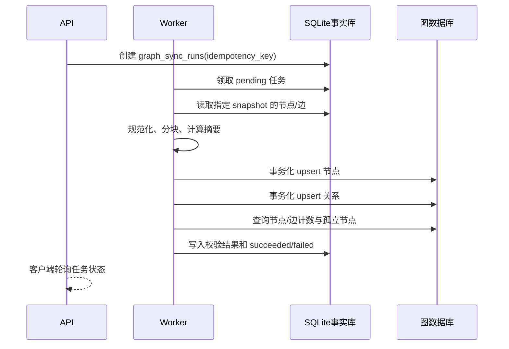

# 数据图谱模块详细设计

## 1. 模块目标与边界

数据图谱模块负责两类能力：

1. 将岗位事实库中的岗位、技能、分类、企业、来源、证据和快照转换为图谱读模型。
2. 为全景探索、岗位精读、技能反查、证据溯源和版本比较提供稳定接口。

它不负责抓取网页、生成原始技能抽取结果，也不直接计算简历匹配分数；这些模块通过稳定的岗位键、技能键和快照键与图谱模块连接。

## 2. 图谱语义模型

### 2.1 节点

| 标签 | 业务键 | 来源 | 关键属性 |
|---|---|---|---|
| `JobCategory` | `job_category:{id}` | `job_categories` | level、parent、code |
| `Job` | `job:{id}` | `job_positions` | code、emerging、version |
| `SkillCategory` | `skill_category:{id}` | `skill_categories` | level、parent、code |
| `Skill` | `skill:{id}` | `skills` | type、trend、demand_score |
| `Company` | `company:{id}` | `companies` | normalized_name |
| `DataSource` | `source:{id}` | `data_sources` | type、credibility |

默认全景图不加载 JD 节点，避免 3,322 个文档节点淹没岗位技能结构。JD 作为证据面板按需加载。

### 2.2 关系

| 关系 | 起点→终点 | 用途 |
|---|---|---|
| `HAS_CHILD_CATEGORY` | 分类→子分类 | 分类层级 |
| `CONTAINS_JOB` | 岗位分类→岗位 | 岗位归属 |
| `CONTAINS_SKILL` | 技能分类→技能 | 技能归属 |
| `REQUIRES_SKILL` | 岗位→技能 | 能力图谱核心边 |
| `RECRUITS_FOR` | 企业→岗位 | 企业需求分布 |
| `SUPPORTS_JOB` | 数据来源→岗位 | 来源覆盖 |

`REQUIRES_SKILL` 必须包含 `mapping_id`、importance、proficiency、weight、confidence、version 和 snapshot_code。证据全文不复制到图数据库，通过 `mapping_id` 回查 SQLite。

## 3. 构建流水线



构建步骤：

1. 校验快照状态为 `ready`。
2. 从 `v_graph_nodes`、`v_graph_edges` 或快照专用查询生成中立 DTO。
3. 按节点类型建立唯一约束，再以业务键 upsert。
4. 关系按 `edge_key + snapshot_code` upsert。
5. 全量模式删除该快照中不再存在的派生关系；增量模式只处理差分。
6. 对节点数、边数、孤立岗位、证据覆盖率做一致性校验。
7. 成功后再将该快照设为查询默认值。

图数据库写事务必须幂等，因为驱动的托管事务可能在瞬时故障后重试。写入函数不能依赖进程内可变全局状态。

## 4. 后端组件

| 组件 | 责任 |
|---|---|
| `GraphProjectionBuilder` | 将 SQLite 行转换为节点/边 DTO |
| `GraphSyncService` | 分块、事务、幂等和任务状态 |
| `GraphRepository` | 图数据库适配层 |
| `SqliteGraphFallbackRepository` | 使用 `v_graph_nodes/edges` 的本地降级实现 |
| `GraphQueryService` | 全景、邻域、路径和聚合查询 |
| `SnapshotDiffService` | 快照间新增/删除/修改计算 |
| `EvidenceService` | 关系到 JD 证据的回溯 |
| `GraphReviewService` | 变更审核和当前版本发布 |
| `GraphExportService` | JSON、CSV、GraphML 和静态图导出 |

## 5. API 分组

完整契约见 `docs/api/knowledge_graph.openapi.yaml`。

### 5.1 目录接口

| 方法 | 路径 | 说明 |
|---|---|---|
| GET | `/api/v1/jobs` | 岗位搜索与分页 |
| GET | `/api/v1/jobs/{jobId}` | 岗位详情及图谱摘要 |
| GET | `/api/v1/skills` | 技能搜索与分页 |
| GET | `/api/v1/skills/{skillId}` | 技能详情及关联岗位摘要 |

### 5.2 图谱查询接口

| 方法 | 路径 | 说明 |
|---|---|---|
| GET | `/api/v1/graph/overview` | 分类聚合后的全景图 |
| GET | `/api/v1/graph/neighborhood` | 指定节点 N 跳邻域 |
| GET | `/api/v1/graph/path` | 两节点之间的最短解释路径 |
| GET | `/api/v1/graph/snapshots` | 可查询快照列表 |
| GET | `/api/v1/graph/compare` | 两快照差分 |

### 5.3 证据与审核接口

| 方法 | 路径 | 说明 |
|---|---|---|
| GET | `/api/v1/evidence` | 按关系、岗位、技能查询证据 |
| GET | `/api/v1/evidence/{evidenceId}` | 证据详情及原文上下文 |
| GET | `/api/v1/admin/reviews` | 审核任务队列 |
| PATCH | `/api/v1/admin/reviews/{taskId}` | 领取、通过或驳回 |

### 5.4 构建接口

| 方法 | 路径 | 说明 |
|---|---|---|
| POST | `/api/v1/admin/graph-builds` | 提交全量/增量/校验任务 |
| GET | `/api/v1/admin/graph-builds/{runId}` | 查询构建进度和统计 |

写接口要求 `Idempotency-Key`，重复提交返回同一任务。

## 6. 图谱页面设计

### 6.1 可视层清单

| 视觉层 | 分析任务 | 主视图 | 降级/补充 |
|---|---|---|---|
| 全景图 | 理解领域层级和岗位分布 | 分层/复合网络 | 树形目录、表格 |
| 岗位中心图 | 查看一个岗位的技能结构 | 径向或约束力导向邻域 | 分组技能清单 |
| 技能反查 | 比较技能关联岗位 | 小型网络＋排序表 | 纯排序表 |
| 演化视图 | 比较两个快照 | 差分边＋变更表 | 新增/删除/修改表 |
| 证据面板 | 判断关系可信性 | 文本片段、来源与指标 | 可导出证据表 |

### 6.2 布局策略

- 全景图属于复合层级网络：岗位分类使用分层布局，岗位—技能关系按选择后展开；不默认显示全部跨岗位技能边。
- 岗位中心图属于 hub-and-spoke：岗位固定在中心，必备、加分、可选技能分圈或分组。
- 一般技能关联网络可使用约束力导向布局，但必须固定种子并缓存位置，避免每次打开漂移。
- 演化视图优先保持旧节点位置，只高亮新增、删除和属性变化，避免布局变化被误认为语义变化。
- 稠密视图超过节点或边预算时，后端先聚合，前端不通过缩小文字硬塞全部节点。

### 6.3 渲染责任

- React/页面框架：路由、筛选、面板、URL 状态和数据请求。
- 图谱渲染器：节点/边绘制、选择、缩放、邻域高亮和布局执行。
- 后端：语义、过滤、聚合、快照、证据和布局提示；不返回渲染器专用对象。
- 首版主路线：Cytoscape.js 一类同时支持网络交互和布局扩展的渲染器。
- 小图/静态导出回退：SVG；极稠密网络的后续路线：Canvas/WebGL 渲染，但不改变 DTO。

### 6.4 视觉编码

- 中性上下文：灰色。
- 当前焦点岗位：蓝色。
- 对比/新增：绿色并增加 `+` 标记。
- 删除：红色虚线并增加 `−` 标记。
- 修改：橙色并增加 `~` 标记。
- 必备技能：实线；加分技能：虚线；可选技能：点线。
- 置信度影响线条透明度或宽度，但数值必须在详情中直接显示。

颜色不是唯一编码，确保灰度打印和色觉差异情况下仍可区分。

## 7. 页面状态和 URL 契约

建议 URL：

```text
/graph?view=job&node=job:24&snapshot=baseline-v1&skillType=hard_skill&importance=required&depth=1
```

可共享状态：

- `view`
- `node`
- `snapshot`
- `compareTo`
- `depth`
- `skillType`
- `importance`
- `minConfidence`
- `category`

不写入 URL：原始 JD、简历内容、审核备注、访问令牌、巨大节点列表和自由文本证据。

URL 优先于本地偏好；非法或过期快照回退到最新 `ready` 快照，并给出提示。拖动节点位置等瞬时操作不写浏览器历史，选中岗位、切换快照等语义操作写历史。

## 8. 响应式设计

### 桌面

- 左侧：分类和过滤器。
- 中部：单个主图实例。
- 右侧：节点详情、证据和版本信息。
- 底部可展开：关系表或变更表。

### 移动端竖屏

- 首屏先显示当前岗位/技能摘要和中心图，不加载完整全景网络。
- 筛选器使用底部抽屉，关闭后恢复图谱焦点。
- 证据作为全屏详情页或底部抽屉。
- 提供搜索、上一个/下一个节点和显式缩放按钮，不要求精确点击密集节点。
- 点击命中区域至少 44 CSS px；浏览器单指滚动不被图谱抢占。

### 移动端横屏

用于用户主动进入“全屏图谱检查”模式，允许双指缩放和左右分栏。竖屏不弹窗强迫旋转。

## 9. 性能预算

单页默认只有一个图谱实例：

| 场景 | 节点预算 | 边预算 | 策略 |
|---|---:|---:|---|
| 岗位中心图 | ≤150 | ≤300 | 浏览器布局和渲染 |
| 聚合全景图 | ≤500 | ≤1,000 | 分层布局、按需展开 |
| 深度探索 | ≤2,000 | ≤5,000 | 后端过滤、布局缓存、Canvas 路线 |
| 超过预算 | 不直接呈现 | 不直接呈现 | 聚合、矩阵、表格或分页 |

当前 v2 兼容视图是 421 个节点、2,475 条边，因此默认全量边已经超过首屏全景预算。全景接口必须支持聚合和 `maxNodes/maxEdges`，不能一次全部返回。

## 10. 错误和降级状态

- 图数据库不可用：使用 SQLite `v_graph_nodes/edges` 提供一跳邻域和有限全景。
- 构建中：保留上一个 `ready` 快照并标记 stale，不显示空白画布。
- 数据部分缺失：返回 `partial=true`、缺失原因和可用计数。
- 节点不存在：返回 404 和可搜索的替代项。
- 请求超过预算：返回 422，附建议的过滤条件或聚合级别。
- 无证据关系：允许展示，但明确 `evidenceStatus=missing`，并生成审核任务。

## 11. 关键验收用例

1. 选择“机器人软件工程师(ROS/ROS2)”后，只加载其一跳技能并可查看每条边的证据。
2. 选择“ROS2”后，可反查岗位并按证据数量/置信度排序。
3. 相同构建请求重复执行，节点和边数量不增长。
4. 图数据库写入中途失败时事务回滚，原 `ready` 快照继续可查。
5. 比较两个快照时，新增/删除/修改数量与 `change_events` 一致。
6. 360 px 宽度下能搜索岗位、选择技能、打开证据并返回图谱。
7. 键盘可以完成搜索、选择、打开详情和关闭抽屉。
8. 静态截图不依赖 hover 也能说明当前岗位、图例、快照和来源状态。

## 12. 下一步实现切片

第一切片只实现：

1. `GraphProjectionBuilder` 读取 v2 数据库。
2. JSON 图谱导出和一致性校验。
3. 图数据库全量幂等同步。
4. `/graph/overview`、`/graph/neighborhood`、`/evidence`。
5. 岗位中心图和证据抽屉。

第二切片增加快照差分和审核；第三切片再增加路径查询、技能反查和高级聚合。
